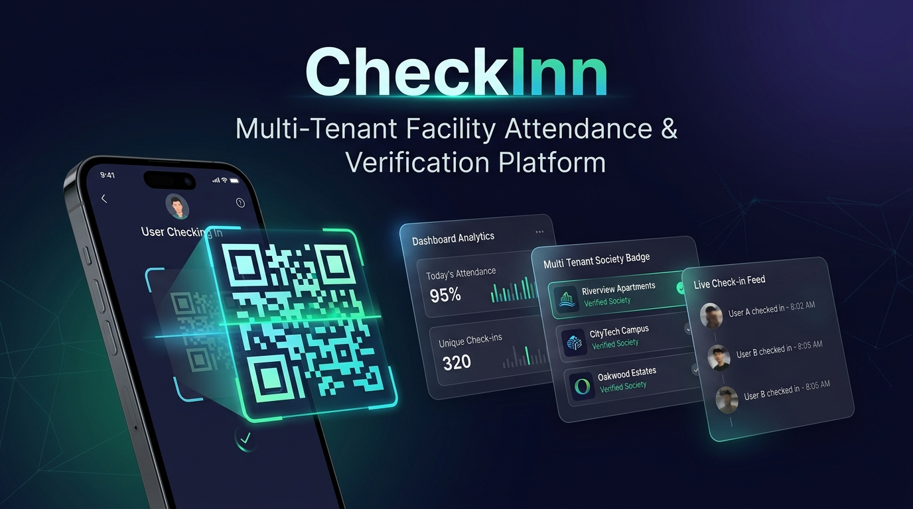

  

# CheckInn Community & Documentation Hub 🏢📍

Welcome to the official public **CheckInn Community Hub**! This repository serves as the public gateway for:

- 📖 **[User Guide & Manual](USER_GUIDE.md)** for Managing Committees, Estate Managers, and Service Technicians.
- 🐛 **[Issue & Bug Reporting](https://github.com/ksprashu/checkinn-community/issues/new?template=bug_report.md)**: Report bugs or operational glitches encountered in the live CheckInn application.
- 💡 **[Feature Requests & Ideas](https://github.com/ksprashu/checkinn-community/issues/new?template=feature_request.md)**: Propose new capabilities, inspection checklist types, and integrations.
- 💬 **[Community Discussions](https://github.com/ksprashu/checkinn-community/discussions)**: Ask questions, share facility best practices, and connect with other residential & commercial societies.

---

## 🧭 About CheckInn

**CheckInn** is a production-grade, multi-tenant facility attendance and compliance platform for residential gated communities and commercial campuses. It enables:

* **Foolproof Mobile Check-ins (PWA)**: Field technicians (Sewage Treatment Plant operators, pump room crews, security) authenticate with secure hashed PINs and scan station QR codes as physical proof-of-presence.
* **Dynamic Inspection Checklists**: Station-specific parameter forms (e.g. water level, pH, dissolved oxygen, pressure gauges) completed during check-in with out-of-bounds validation.
* **Managing Committee Portals**: Real-time attendance KPIs, downloadable high-DPI QR signage, and audit-compliant CSV compliance exports.
* **Multi-Society Mobility**: Technicians can operate across multiple societies seamlessly with independent PINs and schedules.

---

## 🛠️ How to Report an Issue or Glitch

You can report issues either:
1. **Directly from the CheckInn app**: Click the **"Report Bug / Feedback"** button in the dashboard navigation bar. The app will automatically capture your client runtime diagnostics (route, browser specs, timestamp) and open a pre-filled issue.
2. **Directly on GitHub**: Visit [Issues → New Issue](https://github.com/ksprashu/checkinn-community/issues/new/choose) and select a template:
   * **[Bug Report](https://github.com/ksprashu/checkinn-community/issues/new?template=bug_report.md)**
   * **[Feature Request](https://github.com/ksprashu/checkinn-community/issues/new?template=feature_request.md)**

---

## 📚 Documentation & Guides

* **[CheckInn Complete User Guide](USER_GUIDE.md)**:
  * Super Admin platform licensing guide.
  * Society Admin (Managing Committee) setup & checkpoint creation.
  * Facility / Estate Manager worker onboarding & QR signage printing.
  * Service Provider mobile check-in & inspection walkthrough.
